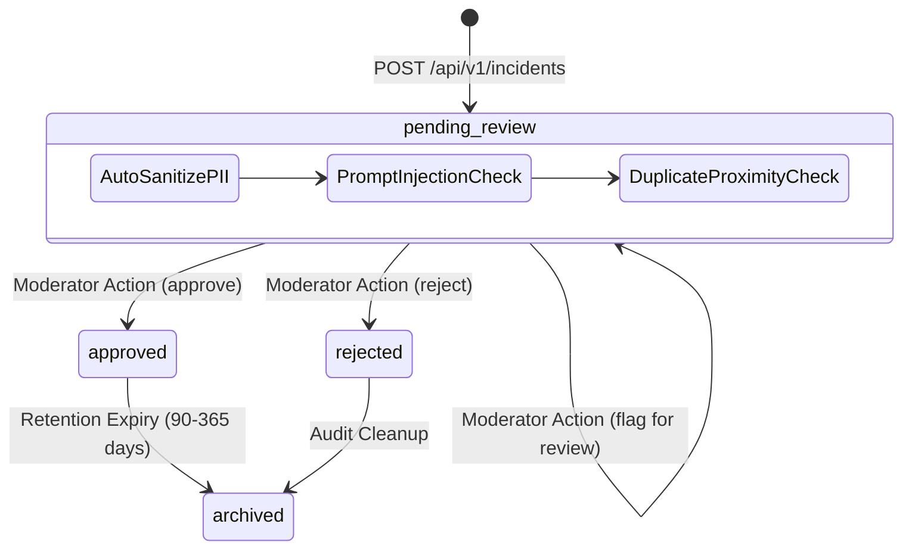

# SafeSphere AI — Moderation & Verification Architecture

**Scope:** Delhi & Sonipat Pilot  
**Version:** 1.0 (Phase 2)  
**Target Architecture:** FastAPI + PostgreSQL 16 / PostGIS + Incident Verification Events

---

## 1. Distinction Between Reporting, Moderation, and Verification

A central tenet of SafeSphere AI is that **moderation approval must never be conflated with factual verification or official record-keeping**. 

To prevent misinformation and algorithmic bias, the system maintains two separate, orthogonal status dimensions:

```
┌───────────────────────────────────┐       ┌───────────────────────────────────┐
│     Moderation Workflow Status    │       │     Factual Verification Status   │
│  (Controlled by Platform Policy)  │       │    (Controlled by Evidence Level) │
├───────────────────────────────────┤       ├───────────────────────────────────┤
│ • pending_review (default)        │       │ • unverified (community submitted)│
│ • approved (visible on maps)      │       │ • under_review (field review)     │
│ • rejected (hidden & archived)    │       │ • verified (independently checked)│
│ • archived (expired / superseded) │       │ • duplicate (corroborates existing│
└───────────────────────────────────┘       │ • officially_recorded (e-FIR/NCRB)│
                                            └───────────────────────────────────┘
```

### Definitions:

1. **Community-Submitted (`unverified`):**
   - The report was submitted by a member of the public through the API or mobile app.
   - It represents an uncorroborated, subjective observation.
   - It enters the moderation queue in `pending_review` state.
2. **Pending Moderation (`pending_review`):**
   - The report is quarantined in the internal moderation queue.
   - It is **strictly excluded** from public spatial queries, API responses, public maps, and LLM context.
3. **Moderated and Approved for Aggregate Analysis (`approved`):**
   - A trained human moderator (or automated policy engine) reviewed the report against community guidelines.
   - The text was confirmed free of defamatory attacks, unredacted PII, prompt injections, and commercial spam.
   - **Approval DOES NOT mean the event has been proven true.** It merely means the observation meets quality standards for public awareness.
4. **Independently Verified (`verified`):**
   - The incident has been corroborated by a vetted partner NGO, local safety audit volunteer, municipal agency, or verified photo evidence.
5. **Officially Recorded (`officially_recorded`):**
   - Corroborated by an official police FIR, Daily Diary entry, Delhi/Haryana Traffic Police alert, or NCRB statistical record.
   - SafeSphere AI does not grant this status without verified public-sector documentation.

---

## 2. Moderation Workflow and State Machine



### State Transition Rules:
- **Default Entry:** All incoming reports enter `pending_review`.
- **Public Isolation:** Public endpoints (`GET /api/v1/incidents` and `GET /api/v1/incidents/nearby`) only return records where `moderation_status = 'approved'`.
- **Audit Logging:** Every transition generates an immutable record in `incident_verification_events` capturing:
  - `incident_id`
  - `event_type` (`submitted`, `flagged`, `verified`, `rejected`, `duplicate_detected`, `auto_expired`)
  - `performed_by` (moderator ID or `system`)
  - `previous_status` & `new_status`
  - `notes` & timestamp

---

## 3. Moderator Reason Codes

When rejecting, withholding, or flagging a report, moderators must assign one of the following standardized reason codes:

| Reason Code | Application Criteria | Action Taken |
|---|---|---|
| `pii_detected` | Contains unredacted names, phone numbers, or addresses | Auto-redacted by sanitizer; rejected if intent was doxxing |
| `hate_speech_or_harassment` | Communal slurs, ethnic slurs, gender-targeted defamation | Rejected immediately |
| `spam_or_commercial` | Advertising businesses, security vendors, or non-safety links | Rejected immediately |
| `abusive_or_defamatory` | Direct personal attacks or allegations against named individuals | Rejected immediately |
| `unverifiable_or_vague` | Incoherent text, gibberish, or lacking geographic plausibility | Rejected |
| `duplicate` | Identical incident already reported nearby within the same hour | Linked to primary report (`duplicate_of`) |
| `prompt_injection` | Contains instructions intended to manipulate AI systems | Filtered and flagged |
| `out_of_pilot_scope` | Coordinates far outside India boundaries | Rejected |
| `approved_for_public` | Compliant with guidelines, privacy coarsened | Approved for public map layers |

---

## 4. Prompt Injection and LLM Guardrails

In future phases, SafeSphere AI will support Retrieval-Augmented Generation (RAG) and conversational safety agents. To prevent malicious reports from manipulating downstream models (e.g., instructing the bot to report false safe routes or claim police sponsorship), Phase 2 introduces:

1. **Syntax Neutralization:** Patterns matching system instruction headers (`ignore previous instructions`, `system:`, `[INST]`, `<|im_start|>`) are stripped and replaced with `[FILTERED INSTRUCTION]`.
2. **Content Isolation:** Free-text descriptions are stored separately in `description_sanitized`. The raw description is accessible only in the authenticated moderation queue.
3. **Delimiter Boxing:** When passed to downstream LLMs in later phases, community text must be enclosed in non-executable XML data envelopes:
   ```xml
   <community_observation category="theft" status="unverified">
     <!-- Sanitized text with no system prompts allowed -->
   </community_observation>
   ```

---

## 5. Moderator Authentication Architecture

### Current Phase 2 Implementation:
- Authenticated via the `X-Moderator-Key` HTTP header or `Authorization: Bearer <token>`.
- Configured via the `MODERATOR_API_KEY` environment variable.
- In development/sandbox mode, falls back to `safesphere-dev-moderator-key-2026`.
- Missing or invalid keys return `HTTP 401 Unauthorized`.

### Production Roadmap (Phase 3):
- Role-Based Access Control (RBAC) via OAuth2 / JWT.
- Moderator tiers: Level 1 (Community Reviewers), Level 2 (Senior Geospatial Editors), Level 3 (Emergency Escalation Supervisors).
